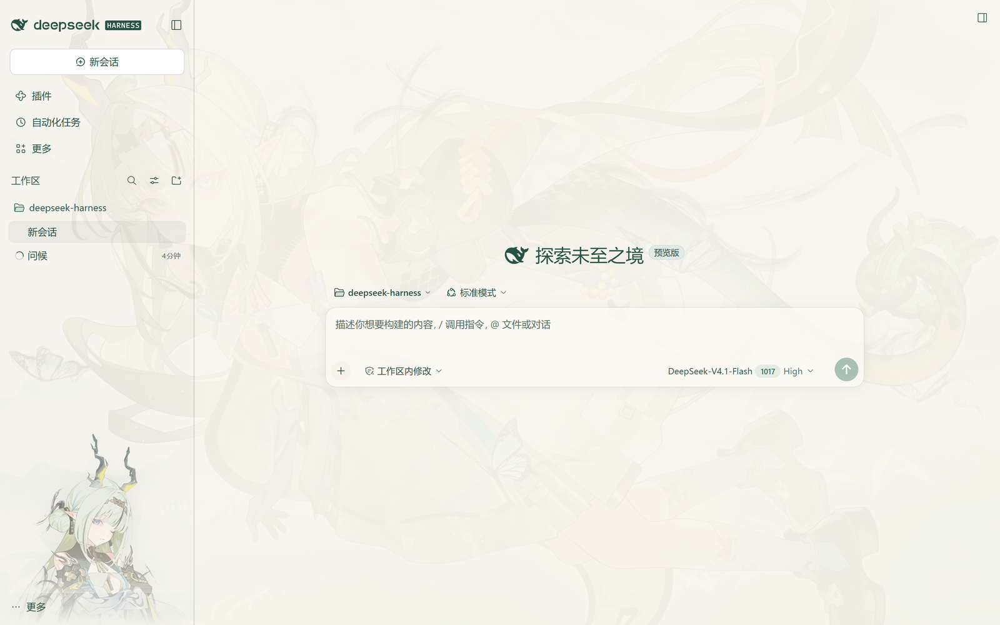
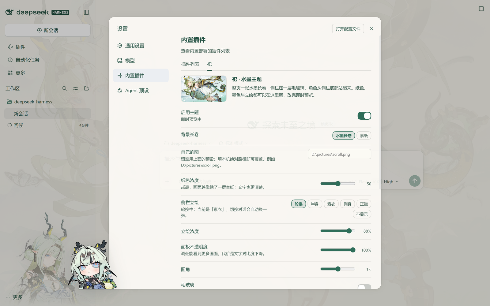

# 祀 · dsh-theme-su

DeepSeek Harness 的祀主题

纸色是象牙白，墨色是新墨，强调色是青玉。纸色、立绘、圆角、毛玻璃等观感都能在设置里调，改完即时预览。

## 界面





## 效果

- **整页长卷**：一张水墨长卷铺满窗口，上面覆一层可调的纸色，文字始终清楚。
- **宣纸侧栏**：半透明的侧栏，可选毛玻璃；底部角色立绘。
- **立绘轮换**：四张同尺度的半身像，切换对话时换一张，也可以固定其中一张或隐藏。
- **三套纸墨**：青玉、新墨、苔痕，深浅两套画布同步变化。
- **设置页**：实时预览所有主题参数，左下角还有一只 Q 版祀。
- **开屏动画**：打开或刷新页面时先播动画，播完淡出。
- **随时可关**：关掉「启用主题」，界面与没装插件时完全一致。

## 安装

从 GitHub 安装（不需要先克隆仓库）：

```bash
dsh plugin --profile <profile> add github:MikamiLing/dsh-theme-su
```

装好后重启 DeepSeek Harness。

如果拿到的是 zip 包，按包内的 `安装说明.txt` 接入即可，同样只需要一次 `pnpm install`。

## 设置

**设置 → 内置插件 → 祀**。主题改动即时预览，「保存」后写入 `$DSH_HOME/dsh-theme-su/config.json`。

| 项 | 默认 | 说明 |
|---|---|---|
| 启用主题 | 开 | 关闭后与未安装插件完全一致 |
| 背景长卷 | 水墨长卷 | 水墨长卷 / 素纸 |
| 自己的图 | 空 | 本机图片的绝对路径，覆盖预设；路径失效时回退预设 |
| 纸色浓度 | 50 | 越高越像覆了一层宣纸，文字越清楚 |
| 侧栏立绘 | 轮换 | 轮换 / 半身 / 素衣 / 侧身 / 正襟 / 不显示 |
| 立绘浓度 | 88 | 立绘的不透明度 |
| 面板不透明度 | 100 | 调低能看到更多画面，代价是对比度 |
| 圆角 | 1× | 0–2 倍 |
| 毛玻璃 | 关 | 打开后侧栏会做模糊；默认关，画面更清楚 |
| 纸墨 | 青玉 | 青玉 / 新墨 / 苔痕 |
| 启用开屏动画 | 开 | 关闭后启动直接进入界面 |
| 填充方式 | 拉伸 | 拉伸 / 自适应 / 完整 / 铺满 |

开屏动画的改动在**下次打开或刷新页面**后生效；主题本身的改动始终即时预览。

### 用配置文件覆盖

设置页里存的值也可以写在 profile 的 `cordis.patch.yml` 里（优先级更高）：

```yaml
- id: dsh-theme-su
  config:
    accent: ink
    scrim: 60
    portrait: front
    splashEnabled: true
    splashFit: fill
```

## 开屏动画

默认播放内置短片，设置页里提供「启用开屏动画」与「填充方式」两项；其余参数取默认值：静音、播完淡出、右下角有「跳过」，Esc / 空格 / 回车也能提前退出。

- **换素材**：把视频和它的首帧海报**成对**写进配置（`splashSrc` + `splashPosterSrc`）。只给视频不给海报时会退回纯色底色，避免贴一张不属于这段视频的画面。
- **支持的格式**：视频 mp4 / m4v / webm / mov / mkv / ogv / mpg / mpeg / ts；海报 jpg / png / webp / avif。`.mov` / `.mkv` 能否播放取决于内部编码，解不了的会自动跳过，不会卡在开屏。
- **首帧不黑**：内置素材自带一张与视频第一帧一致的海报，播放前先显示它，视频解出画面后再淡出交接。
- **关闭**：设置里关掉「启用开屏动画」，或在配置里设 `splashEnabled: false`。

换素材的配置示例：

```yaml
- id: dsh-theme-su
  config:
    splashSrc: D:/videos/opening.mp4
    splashPosterSrc: D:/videos/opening-poster.jpg
```

`填充方式` 可选 `fill`（拉伸铺满）、`adaptive`（完整画面 + 模糊背景）、`contain`（完整留边）、`cover`（铺满裁切）。开屏的完整字段还包括 `splashSkip`、`splashSkipAfterMs`、`splashMuted`、`splashVolume`、`splashFadeInMs`、`splashFadeOutMs`、`splashPlaybackRate`、`splashWaitForAppMs`、`splashHoldAfterEndMs`、`splashMaxReplays`、`splashDuration`。

> 内置短片约 15 秒、15 MB。想让它短一些，可以用 `splashDuration`（毫秒）截断。

## 常见问题

- **切回同一个对话，立绘变了**：这是有意的——立绘是「每次切换换一张」，不和对话绑定；想固定就用设置里的单张。
- **开屏改动没生效**：开屏只在页面加载时读取，改完刷新页面或重开 DSH；主题本身的改动是实时的。
- **深色模式下立绘更淡**：这是刻意的——夜墨底色上会压低立绘浓度并略微提亮，否则像贴在黑板上。
- **与其他主题插件同时安装**：两个主题会各自接管配色，只能保留一个。
- **「自适应」更吃显卡**：它为了填满窗口会同时解码前景与背景两份画面；低配或核显上建议选「完整」或「铺满」。
- **Electron 自己的启动小鲸鱼**：那是 DSH 程序自身的启动画面，出现在页面之前，插件接管不到。

## 卸载

在 **设置 → 内置插件** 里停用，或把 profile `package.json` 里的依赖与 bundles 条目删掉后重跑 `pnpm install`。

## 致谢与许可

- 开屏动画实现逻辑参照 [dsh-splash-animation](https://github.com/KDDKBD/DeepSeek-splash-animation)（MIT），详见 [THIRD_PARTY_NOTICES.md](THIRD_PARTY_NOTICES.md)。
- 设计语言参考了社区里的「特蕾西娅」主题。
- 插件代码以 MIT 发布；`assets/` 内的立绘素材版权归原画作者，仅供个人学习交流，禁止商用，侵权请联系删除。
