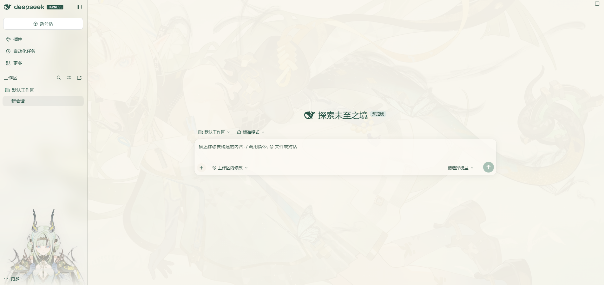
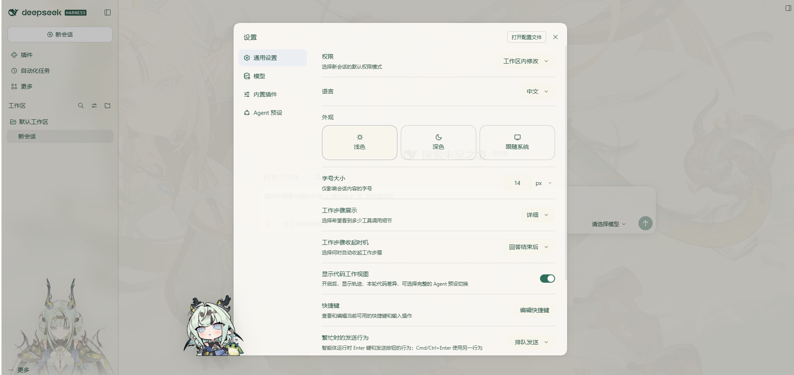

# 祀 · dsh-theme-su

给 [DeepSeek Harness](https://github.com/deepseek-ai/deepseek-harness) 的水墨主题：**整页一张水墨长卷**，侧栏压一层毛玻璃，**角色从侧栏底部站起来**；纸色是暖象牙白，墨色是新墨，强调色是青玉。全部可调。

设计语言参考了社区里的「特蕾西娅」主题（整页背景 + 毛玻璃侧栏 + 侧栏立绘），但去掉了金线描边、落款签名与开屏动画，配色也换成配合这套素材的青玉/墨。

素材已内置在 `assets/` 里，开箱即用（版权归原画作者，见 [LICENSE](LICENSE)）：

| 资源 | 用在 |
|---|---|
| `wallpaper-scroll.webp` 水墨长卷 | 整页背景 + 设置页横幅（16:9 裁切） |
| `bust.webp` 半身 | 侧栏立绘（正面握飘带） |
| `bust-su.webp` 素衣 | 侧栏立绘（低头抱臂） |
| `bust-front.webp` 正襟 | 侧栏立绘（正面、双手扶领口） |
| `bust-side.webp` 侧身 | 侧栏立绘（原图画得较小，按头部比例单独裁成同一头身比） |
| `mascot.webp` / `icon-256.png` Q 版 | 设置界面左下角吉祥物 / 应用图标 |





## 它做了什么

| 层 | 做法 |
|---|---|
| 长卷 | 画在 `body` 背景上（`fixed` + `cover`），上面盖一层按主题变色的"纸色蒙版"；深色模式蒙版加重，避免浅色水墨在暗底上糊成一片 |
| 侧栏 | 半透明填充 + `backdrop-filter` 毛玻璃；`::after` 放立绘，底部用遮罩渐隐进页脚 |
| 立绘 | 素材是白底稿，用「亮度 + 饱和度」双通道抠图去掉纸白——只按亮度抠会把脸和裙子抠成半透明，深色下变成一张灰面具 |
| 配色 | 覆盖 `--dsw-*` token：底色、边框、气泡、文字、强调色整条色阶用 `color-mix` 从强调色推导 |
| 细节 | `--dsw-radius-*` 统一放大、滚动条与选中色跟随强调色、焦点环改色 |

**首帧不闪**：宿主在 index 响应里内联一段同源 token 子集，页面第一帧就是宣纸色。

## 安装

从 GitHub 装（推荐，无需先克隆）：

```bash
dsh plugin --profile <profile> add github:MikamiLing/dsh-theme-su
```

本机开发时用 `link:`：

```bash
dsh plugin --profile <profile> add link:E:\path\to\dsh-theme-su
```

或手动：profile 的 `package.json` 依赖里加 `"dsh-theme-su": "github:MikamiLing/dsh-theme-su"`（本地开发则写 `link:` 路径），`dsh.profile.bundles` 里加 `"dsh-theme-su"`，在该目录 `pnpm install`。装完**重启 DSH**。

零运行时依赖、无构建步骤：`client.js` 是手写的 client-module，`index.js` 只用 Node 内建模块。

## 设置

**设置 → 内置插件 → 祀**。改动即时预览，「保存」写入 `$DSH_HOME/dsh-theme-su/config.json`。

| 项 | 默认 | 说明 |
|---|---|---|
| 启用主题 | 开 | 关掉后与未安装插件完全一致 |
| 背景长卷 | 水墨长卷 | 水墨长卷 / 素纸 |
| 自己的图 | 空 | 本机绝对路径，覆盖预设；失效时回退预设 |
| 纸色浓度 | 50 | 越高越像覆了一层宣纸，文字越清楚 |
| 侧栏立绘 | 轮换 | 轮换 / 半身 / 素衣 / 侧身 / 正襟 / 不显示 |
| 立绘浓度 | 88 | 立绘不透明度 |
| 面板不透明度 | 100 | 调低看到更多画面，代价是对比度 |
| 圆角 | 1× | 0–2 倍 |
| 毛玻璃 | 开 | 侧栏的 `backdrop-filter` |
| 纸墨 | 青玉 | 青玉（青绿）/ 新墨（近无彩）/ 苔痕（苔绿） |

配置也可写在 profile 的 `cordis.patch.yml`（优先级高于设置页）：

```yaml
- id: dsh-theme-su
  config:
    accent: ink
    scrim: 60
    portrait: tall
```

## 轮换是怎么算的

默认的「轮换」不是定时切换，而是**跟着当前对话走**：插件从侧栏行的 `data-row-key`（形如 `session:<id>`）或 session store 里取当前会话 id，对它做一次 FNV-1a 哈希，再 mod 4 落到 半身 / 素衣 / 侧身 / 正襟 四张里的一张。

- 切到另一个对话 → 通常换一张（同一个对话永远是同一个人，来回切不会错位）
- 点工作区标题、分组行、占位行 → 不算切对话，立绘不动
- 搜索面板、快捷键打开另一个会话也能跟上（走 session store 那条路径）

池子里只有四张**同尺度的半身**立绘（头身比一致，所以切换时不会一大一小）。

## 图标与吉祥物

Q 版（`002.jpg`）不做侧栏立绘——它和这套水墨立绘的画风差得太远，放进侧栏会显得跳。但它在两个位置很合适：

- **设置界面左下角**：打开设置时，Q 版站在设置卡片左下角外侧，关掉设置立刻消失。实现上不往 React 的树里塞节点——读 `[data-shortcut-modal="settings"]` 的 rect，把 body 级的 `position: fixed` 图片摆到卡片边缘；`pointer-events: none`，不影响任何点击。
- **应用图标**：
  - 桌面 / 开始菜单快捷方式：多尺寸 `dsh-icon.ico`（16–256）装到 `%LOCALAPPDATA%\dsh-theme-su\dsh-icon.ico`，两个 `.lnk` 的 `IconLocation` 指过去。原图标位置记录在 `$DSH_HOME\backups\si-shortcut-icons.json`，想还原就把那个路径写回快捷方式属性。
  - 浏览器标签页：`index.html` 里原本有两张按配色方案切换的 svg 图标（带 `media`），插件运行时整组换掉，改成同一张 PNG。
- 窗口左上角 / 任务栏的运行中图标来自 exe 内嵌资源，不改 `app.asar` 换不掉，属于预期。

## 已知限制

- **壁纸没有运行时模糊**：`body` 背景不能单独模糊；负 `z-index` 的伪元素层在深色模式下会被 Chromium 的根背景吃掉（浅色正常），所以长卷直接画在 `body` 上，靠「纸色浓度」控制观感。
- **深色下立绘更淡**：深色是夜墨，立绘浓度乘 0.72 并提亮，避免人物像贴在黑板上。
- **接管配色**：所有颜色 token 带 `!important`，否则会和 DSH 自带主题样式表打架，得到半套配色。装别的主题插件时二者只能留其一。
- 侧栏很窄（264–420px）时半身立绘会贴近两侧边缘；这是按侧栏宽度自适应 `contain` 的结果。

## 卸载

设置 → 内置插件里停用，或删掉依赖与 bundles 条目后重跑 `pnpm install`。

## 许可

插件代码 MIT。`assets/` 里的图片来自本机素材，版权归原作者。
